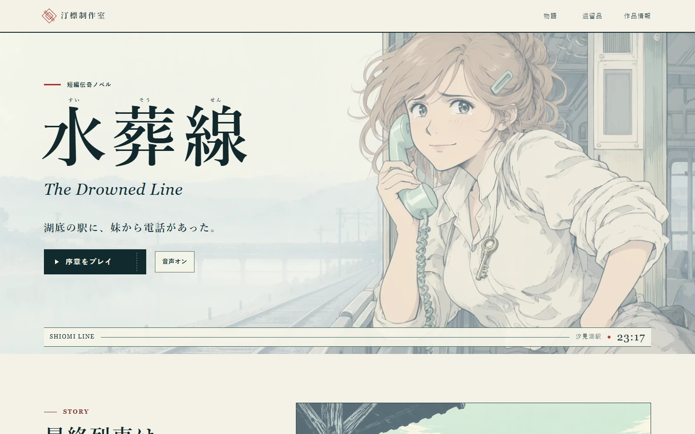

# Anything Frontend Product Design

Webプロダクトを、利用者が用事を終えるところまで設計・検証するためのスキルです。たとえば予約変更なら、対象の予約を見つけ、新しい日時を選び、ページを開き直しても変更後の日時を確認できるところまでを扱います。クリック数、要素間の余白、画面内の情報密度を測り、どこを直すか判断します。

[スキルを読む](SKILL.md) · [製品評価チェックリスト](references/product-checklist.md) · [動く作例『水葬線』を開く](https://rna4219.github.io/anything-frontend-product-design/)

## 自分のプロダクトで使う

このリポジトリを手元に置き、対象の画面と `SKILL.md` を参照できる状態で、エージェントに利用者の用事を一つ指定します。予約変更画面なら、次のように依頼できます。

> この予約変更画面を、Anything Frontend Product Design の製品評価チェックリストで点検してください。利用者の用事は「12月8日14時の工作室の予約を、12月10日14時に変更する」です。PCではクリック数、スマートフォンではタップ数を数え、確定後にページを開き直して日時を確かめてください。希望枠が埋まっていた場合は、元の予約が残り、別の枠を選べるかも確認してください。

最初に「何を確認できれば完了か」を書き、次に実際の画面で測ります。結果には画面幅、入力方法、操作数、最後に表示された内容を残します。この例の初期データと受入条件も同梱しています。[予約変更の課題](tests/fixtures/booking-change.md) · [チェックリストと記入欄](references/product-checklist.md)

| 困っていること | 使うスキル |
| --- | --- |
| 利用者が目的の予約を見つけられない | [A　機能と情報設計](modules/product-information-architecture/SKILL.md) |
| 日時変更の途中で失敗すると元に戻れない | [B　操作フロー](modules/interaction-ux-flow/SKILL.md) |
| ダイアログを閉じるとキーボードの操作位置が分からなくなる | [C　UI部品の設計と実装](modules/ui-engineering-design-system/SKILL.md) |
| 修正後に何を測ればリリースできるか決めたい | [D　検証とリリース判定](modules/design-qa-evaluation/SKILL.md) |

### Art Direction と一緒に使う

操作の流れと見た目を一緒に決めたいときは、このスキルと [Art Direction](https://github.com/RNA4219/anything-frontend-art-direction) の両方の `SKILL.md` をエージェントが読める状態にします。[受け渡しの記入例](references/handoff.md#art-direction)

> Product Design と Art Direction を使って、予約変更の確認画面を改善してください。利用者は工作室の予約を12月8日14時から12月10日14時へ変更します。確定前に二つの日時を見比べられる配置と文字の強弱を決め、スマホでの確定後、ページを開き直して新しい日時を確認してください。

## 実サイトの測定記録を引く

たとえば「スマートフォンでパスワードの再設定方法を探す」経路は、リポジトリのルートで次のコマンドを実行すると調べられます。

```sh
python scripts/find_journeys.py --task reset --mode mobile --status confirmed --view layout --limit 1
```

Adobeの観察例は、再設定方法を案内記事で確認するまでに**2タップと1回のスクロール**。画面内の操作要素は入口の3個から記事の9個へ、文字が占める面積の割合は10.23%から22.94%へ変わりました。操作数は同じコマンドの `--view layout` を `--view actions` に替えて確認できます。[Adobeの観察記録](research/product-journeys/expansion/reset.md#reset-adobe-mobile) · [余白と密度の測定方法](research/product-journeys/spacing/README.md)

用件別の索引から、商品探し、誤入力からの復帰、店舗の営業時間なども引けます。利用者が実際に迷った時間や達成率を調べたいときは、人を対象にした研究を参照してください。[実サイトの用件別索引](references/site-comparisons.md) · [29ブランド・施設の観察](research/product-journeys/walkthrough/README.md) · [追加観察](research/product-journeys/expansion/README.md) · [利用者を観察した研究](research/product-journeys/human-studies/README.md) · [設計ルールと原典](research/design-evidence/README.md)

## 動く作例『水葬線』

湖に沈んだ駅から、十二年前に亡くした妹が電話をかけてくる。『水葬線』は、架空の短編伝奇ADVの作品サイトです。「序章をプレイ」から読み始め、赤い灯を振るか、受話器を握るかを選ぶと、異なる結末にたどり着きます。台詞と紹介文は差し替え用の仮稿です。序章の全9場面に、澪の語りと妹の声を収録しました。

**[作品サイトで序章をプレイ](https://rna4219.github.io/anything-frontend-product-design/)** · [オフライン用の単体HTMLを保存](https://rna4219.github.io/anything-frontend-product-design/#download) · [スマートフォンでの表示](assets/suisosen-mobile.webp)

[](https://rna4219.github.io/anything-frontend-product-design/)

| 確認したこと | Chromeでの結果 |
| --- | --- |
| 初めて開いてから一つの結末を読むまで | 文字の即時表示時は7操作。起動1回、台詞送り4回、選択1回、最後の台詞送り1回。 |
| 紹介文とプレイボタンの距離 | 390 × 844 CSS pxのタッチエミュレーションで14px。ボタンの上端は画面上端から621px、高さは52px。320px幅でも横スクロールは0px。 |
| 中断した場面に戻る | 分岐直前に保存した栞をロードすると、同じ台詞と二つの選択肢に戻る。ダウンロードしたHTMLでも、通信を切って終幕まで確認。 |

<details>
<summary>水守澪の人物画と、音が鳴る場面</summary>

- **人物画と背景**。DGXのMOSS-Imageで主人公、水没駅、駅務電話を描きました。澪は妹の声を疑うように片眉を上げ、巻いた栗色の髪を青磁色の髪留めでまとめています。生成りの保線服には駅の鍵を留めました。太い輪郭と平らな色面を参照し、浅い湖の色と細い線が読める淡色に調整しました。[『パラノマサイト』登場人物](https://www.jp.square-enix.com/paranormasight/character/) · [『都市伝説解体センター』作品紹介](https://shueisha-games.com/games/umdc/)
- **劇伴と効果音**。YuE2で作譜・生成した約3分59秒の原曲から、劇伴「汐見湖、二十三時十七分」の約54秒のループを編集しました。電話の二連ベル、切符を切る音、硬貨が跳ねる音、車輪音は、別にYuE2で生成した打楽器素材の打音を編集したものです。ボイス中は伴奏が自動で小さくなります。[YuE2](https://github.com/multimodal-art-projection/YuE)
- **ボイス**。Irodori-TTS-v4-Largeで澪と妹の声を生成。電話越しの妹には帯域を狭める処理を加え、同じ場面で妹の台詞から澪の語りに移る箇所でも声を切り替えています。[Irodori-TTS-v4-Large](https://huggingface.co/Aratako/Irodori-TTS-v4-Large)

</details>

<details>
<summary>初版の依頼文と、4つのスキルを2周使った記録</summary>

> 架空の伝奇ADVの作品サイトと、二つの結末まで遊べる序章を単体HTMLで作ってください。Product Design、Art Direction、Motion Atlas、unslopを一つずつ順に使ってください。1周目は起動から終幕までを作り、2周目は390px幅の表示とキーボード操作を試して直してください。画像はDGXのMOSS-Imageで生成し、台詞は差し替えられる仮稿にしてください。

| 順番 | 1周目 | 2周目 |
| --- | --- | --- |
| 1. [Product Design](SKILL.md) | 序章の起動から終幕までをつなぎ、分岐前に栞を保存できるようにした。 | キーボードで分岐へ進むと操作位置が外れたため、最初の選択肢にフォーカスを移した。 |
| 2. [Art Direction](https://github.com/RNA4219/anything-frontend-art-direction) | 『魔法使いの夜』の雨の街と赤い傘の構図を参照。青い湖と赤い襟巻きを軸に、主人公・水没駅・業務電話の3枚をDGXのMOSS-Imageで生成した。[公式の物語紹介](https://www.typemoon.com/products/mahoyo/story.html) · [MOSS-Image](https://openmoss.ai/MOSS-Image/) | 390px幅で主人公の片目が切れたため、縦画面の切り取り位置を変えた。 |
| 3. [Motion Atlas](https://github.com/RNA4219/motion-atlas) | タイトルの登場に「Soft enter」の動きを使い、台詞は表示途中でも全文を出せるようにした。[参照した作例](https://github.com/RNA4219/motion-atlas/blob/8cff76041b06a30d7f4b4b9f79979b8e30512f60/src/cinema.js) | 背景が変わるときだけ前の絵を340msかけて消すようにした。端末で「動きを減らす」を選ぶと即時表示になる。 |
| 4. [unslop](https://github.com/heydamir/unslop) | 最初の画面の主な操作を「序章をプレイ」に絞り、終電時刻を添えた。 | 外部リンクに見えた矢印を切符の切り取り線に替え、スマートフォンの読書画面では6個の補助操作を2段にそろえた。 |

</details>

<details>
<summary>序章の操作と台本の編集方法</summary>

本文をクリック／タップすると、表示途中なら全文が現れ、表示後なら次に進みます。キーボードでは → で送り、← で一つ戻り、選択肢は Tab と Enter で選びます。「履歴」で通った台詞を読み返せます。「既読スキップ」は未読の手前で止まり、「オート」も選択肢で待ちます。「セーブ・ロード」には3つの栞があります。

表紙の「音声オン」で、序章を始める前に消音できます。序章の「音量」でBGM・効果音・ボイスを個別に調整でき、オートは台詞の再生が終わってから進みます。劇伴だけ聴くには、作品情報の再生ボタンを押してください。

台本は吉里吉里／KAGのページ待ち・分岐を参考にした、この作例のブラウザープレイヤー用です。本文・話者・選択肢を編集したら、次のコマンドで単体HTMLに反映します。ラベル名はセーブ位置にも使います。台詞を変えた場面は古いボイスを再生しません。再収録後、配布HTML内の `soundBank` にある該当ラベルのMP3と収録本文を差し替えてください。[序章の台本](examples/suisosen/prologue.ks) · [配布HTML](docs/index.html) · [KAG3のタグリファレンス](https://krkrz.github.io/krkr2doc/kag3doc/contents/Tags.html)

```sh
python examples/suisosen/sync_scenario.py
python examples/suisosen/sync_scenario.py --check
```

</details>

## ライセンス

このリポジトリのコードと作例はMITライセンスで配布しています。作例で参照したunslopの作者はDamir Sokolovskyで、同スキルにはCC BY 4.0が適用されます。第三者の資料には各原典の条件が適用されます。[MIT License](LICENSE) · [unslopのライセンス](https://github.com/heydamir/unslop/blob/main/LICENSE)
