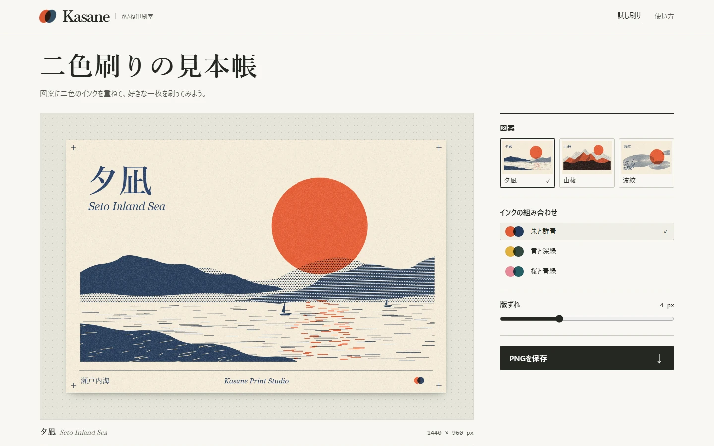

# Anything Frontend Product Design

フロントエンドを作るときに、「利用者が何を選び、どう操作し、何をもって完了とするか」を決めるスキルです。たとえば画像を書き出す画面なら、保存ボタンの見た目に加えて、ダウンロードした画像が直前のプレビューと一致するところまで確かめます。

## 動く作例「かさね印刷室」

**[ブラウザーで試し刷りする](https://rna4219.github.io/anything-frontend-product-design/)** · [単体HTMLをダウンロード](https://github.com/RNA4219/anything-frontend-product-design/raw/refs/heads/main/docs/index.html) · [ソースを読む](docs/index.html)

最初は「夕凪」が朱と群青で表示されます。「山稜」→「桜と青緑」→「PNGを保存」と選ぶと、その配色の山並みを **1440 × 960 px** の画像にできます。版ずれを0〜12 pxの範囲で変えると、二色目の輪郭が右へずれます。ダウンロードしたHTMLはオフラインでも使えます。

Chromeでは、この手順がPC幅で3クリック、スマートフォン幅のタッチエミュレーションで3タップでした。390 × 844 CSS pxの画面では、図案の選択欄をコンパクトにすると保存ボタンの上端が867 pxから782 pxに上がり、初期画面内に収まりました。320 px幅でも横スクロールは発生しませんでした。

### 4つのスキルをどう組み合わせたか

| 使ったスキル | この作例で決めたこと |
| --- | --- |
| [Anything Frontend Product Design](SKILL.md) | 「別の図案と配色を選んで保存する」を課題に設定。ダウンロードしたPNGをブラウザーで読み戻し、寸法と全画素がプレビューに一致することを確認した。 |
| [Anything Frontend Art Direction](https://github.com/RNA4219/anything-frontend-art-direction) | 印刷工房のガイドにある色版の重なりと版ずれの図を手がかりに、紙色の上に二つの色版を別々に描画。大きな一枚を見せる縦一列の案と比べ、PCでは刷り上がりと色の選択肢を同時に見られる左右配置を採用した。[参照した印刷ガイド、6ページ](https://web.faa.illinois.edu/app/uploads/sites/6/2021/05/riso_print_guide.pdf#page=6) |
| [Motion Atlas](https://github.com/RNA4219/motion-atlas) | [Geometric wipes](https://github.com/RNA4219/motion-atlas/blob/8cff76041b06a30d7f4b4b9f79979b8e30512f60/src/cinema.js)の直線ワイプを図案の切り替えに応用。220ミリ秒で次の見本を見せる。インクと版ずれは即時反映し、端末の「視差効果を減らす」設定では図案も即時に切り替える。 |
| [unslop](https://github.com/heydamir/unslop) | 紙とインクに視線が集まるように操作面を無彩色に寄せ、選択状態には輪郭とチェックを併用。スマートフォンでは図案名と小見本を横に並べ、保存までの縦の距離を縮めた。 |

### 同じ作例を依頼するプロンプト

> Anything Frontend Product Design、Anything Frontend Art Direction、Motion Atlas、unslopを使って、二色刷りの版画を作るWebアプリを単体HTMLで作ってください。図案は夕凪・山稜・波紋の3種類。インクを選ぶと紙の上の重なりが変わり、版ずれを1 pxずつ調整できるようにしてください。表示中の絵を1440 × 960 pxのPNGで保存できることを完了条件にします。マウス、タッチ、キーボードで操作し、保存した画像とプレビューを照合してください。

別の製品に使うときは、題材と完了条件を一緒に置き換えます。たとえば予約変更なら、「空き枠を選んで確定し、再読み込み後も新しい日時が表示される」が完了条件です。[予約変更の共通課題](tests/fixtures/booking-change.md)

## 自分のプロダクトで使う

[スキルの入口](SKILL.md)から相談に合う担当を選びます。製品を点検するときは、用件ごとに成功条件を先に決め、操作回数、要素間の余白、画面内の情報密度、実際に得られた結果を記録します。[製品評価チェックリスト](references/product-checklist.md) · [担当間の受け渡し](references/handoff.md)

| 担当 | 設計するもの | 担当ディレクトリ |
| --- | --- | --- |
| A | 利用目的、情報の分類と名前、見つけ方 | `modules/product-information-architecture/` |
| B | 操作手順、状態遷移、中断・失敗からの復帰 | `modules/interaction-ux-flow/` |
| C | 実装時の部品選択、部品の契約、デザインシステム | `modules/ui-engineering-design-system/` |
| D | 検証の設計、観察結果、リリース判断 | `modules/design-qa-evaluation/` |

## 設計判断に使える記録

[実サイトの用件別の索引](references/site-comparisons.md)から、操作回数・余白・情報密度を参照できます。[29ブランド・施設の実画面](research/product-journeys/walkthrough/README.md)と[新規12ブランド・施設を含む追加観察](research/product-journeys/expansion/README.md)を収録しています。人の探索時間や達成率については[利用者を観察した研究](research/product-journeys/human-studies/README.md)を参照してください。

[調査資料の置き方](research/README.md)、[検証の実行方法](tests/README.md)、[実行・評価の証跡](evidence/README.md)。

## ライセンス

このリポジトリのコードと作例は[MIT License](LICENSE)で配布します。参照したunslopの作者はDamir Sokolovskyで、スキルのライセンスは[CC BY 4.0](https://github.com/heydamir/unslop/blob/main/LICENSE)です。作例に内蔵する欧文書体BaskervvilleはSIL Open Font License 1.1で配布され、著作権表示とライセンス全文を単体HTMLに収録しています。第三者の原典には各資料の条件が適用されます。
