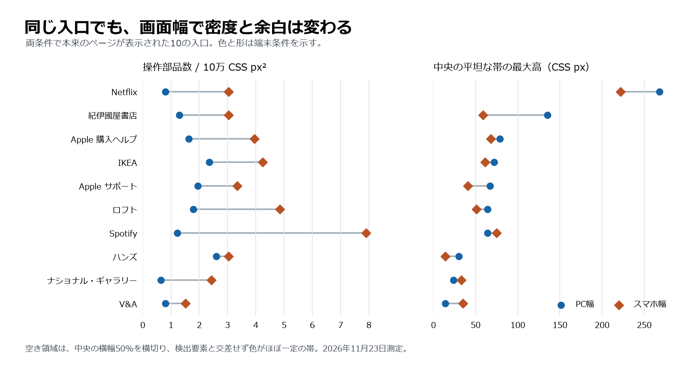

# 初期画面の余白と情報密度

2026年11月23日、前回の調査から16の入口URLを選び、PC幅とスマホ幅で開いた。32条件中26条件で初期表示を取得した。見出しと本文・入力欄の間隔、横並びの操作部品の間隔、画面内の操作部品数、中央を横切る平坦な空き領域の長さを実測した。Appleのサポートと購入ヘルプは入口が異なるため、別の画面として数えた。

## 同じ要素の間隔を端末幅で比べる

| ページと測定箇所 | 方向 | PC幅 | スマホ幅 |
| --- | --- | ---: | ---: |
| Netflixヘルプの見出し → 検索欄 | 縦 | 26 px | 26 px |
| Netflixヘルプの登録リンク → ログインリンク | 横 | 16 px | 16 px |
| ロフトの「お知らせ」見出し → 先頭のお知らせ | 縦 | 20 px | 15 px |
| ロフトの検索欄 → 詳細検索 | 横 | 6 px | 7 px |
| Apple購入ヘルプの冒頭見出し → 直後の説明 | 縦 | 13.6 px | 13.6 px |
| IKEA米国の返品・変更のカード見出し → 説明 | 縦 | 4 px | 4 px |

単位はすべてCSS px。縦は上側要素の下端から下側要素の上端まで、横は左側要素の右端から右側要素の左端まで。文字の輪郭やCSSのmargin値と、要素の矩形から測った間隔には違いがある。上表は両画面で同じ役割を確認できた組み合わせ。全候補の短いラベルと座標は[測定データ](measurements.json)にある。

## ひと目で見える操作数と、要素のない距離

各セルは **画面内の操作部品数 / 10万CSS px²当たりの操作部品数 / 中央の平坦な空き領域の最大高（CSS px）** の順。操作部品にはリンク・ボタン・入力欄を含む。PC幅は1365 × 900、スマホ幅は390 × 844。ルーヴルは初回のCookie選択画面が前面に出た。

| 入口 | PC幅 | スマホ幅 |
| --- | --- | --- |
| [大英博物館](https://www.britishmuseum.org/)・トップ | アクセス制限 | 7 / 2.13 / 20 |
| [ルーヴル美術館](https://www.louvre.fr/en)・トップ | 4 / 0.33 / 147（同意画面） | 4 / 1.22 / 50（同意画面） |
| [ナショナル・ギャラリー](https://www.nationalgallery.org.uk/)・トップ | 8 / 0.65 / 24 | 8 / 2.43 / 33 |
| [V&A](https://www.vam.ac.uk/)・トップ | 10 / 0.81 / 14 | 5 / 1.52 / 35 |
| [ハンズ](https://hands.net/)・通販トップ | 32 / 2.60 / 30 | 10 / 3.04 / 14 |
| [ロフト](https://www.loft.co.jp/store/)・通販トップ | 22 / 1.79 / 64 | 16 / 4.86 / 51 |
| [Apple](https://support.apple.com/en-us)・サポート | 24 / 1.95 / 67 | 11 / 3.34 / 41 |
| [Netflix](https://help.netflix.com/en)・サポート | 10 / 0.81 / 268 | 10 / 3.04 / 222 |
| [Spotify](https://support.spotify.com/us/)・サポート | 15 / 1.22 / 64 | 26 / 7.90 / 75 |
| [Apple](https://www.apple.com/shop/help)・購入ヘルプ | 20 / 1.63 / 79 | 13 / 3.95 / 68 |
| [Argos](https://help.argos.co.uk/)・購入ヘルプ | アクセス制限 | 12 / 3.65 / 35 |
| [IKEA](https://www.ikea.com/us/en/customer-service/)・購入ヘルプ | 29 / 2.36 / 72 | 14 / 4.25 / 61 |
| [BEAMS](https://www.beams.co.jp/category/t-shirt/?label=0023&sex=M)・衣料品一覧 | アクセス制限 | 30 / 9.11 / 31 |
| [GU](https://www.gu-global.com/jp/ja/women/all-item/tops)・衣料品一覧 | アクセス制限 | 取得エラー |
| [ビックカメラ](https://www.biccamera.com/bc/i/shop/shoplist/index.jsp)・店舗一覧 | 取得不能 | 65 / 19.75 / 60 |
| [紀伊國屋書店](https://store.kinokuniya.co.jp/)・店舗一覧 | 16 / 1.30 / 135 | 10 / 3.04 / 59 |

「中央の平坦な空き領域」は、画面中央の横幅50%で、文字・操作部品・画像などの検出矩形と交差せず、かつスクリーンショット上でも色がほぼ一定だった連続領域。対象帯の上下座標も保存した。値が0の画面でも、カード内の余白、左右のガター、中央帯の一部にある空きはありうる。

## 文字の密度とメディアの占有面積

同じ390 × 844 CSS pxの初期画面でも、リンク・ボタンの数、文字が占める面積、写真が占める面積はそれぞれ違う。ハンズとNetflixでは操作部品がどちらも10個だった。ハンズでは文字の矩形が画面の22.76%、検出したメディアの矩形が35.64%を占めた。

| スマホ幅の入口 | 操作部品 | 文字の矩形面積 | メディアの矩形面積 | 中央の平坦な帯 |
| --- | ---: | ---: | ---: | ---: |
| Netflix・ヘルプ | 10個 | 11.84% | 0.35% | 222 px |
| ハンズ・通販トップ | 10個 | 22.76% | 35.64% | 14 px |
| ロフト・通販トップ | 16個 | 8.24% | 51.45% | 51 px |

メディアは検出できた画像・SVGなどの矩形。画像中の文字は文字面積に入らない。原寸画像の大きさ、背景の検出方法、ボタンと画像の重なりも面積率に影響する。[全画面の文字・操作・メディアの集計CSV](summary.csv)

## 再計測する条件

1. Edge 158の新規セッションで各URLを直接開く。スマホはPixel 7相当のタッチ・UA・端末倍率をエミュレートし、時刻帯は日本、国内サイトの言語は日本語、他は米国英語にした。DOM読み込み後に2秒待ち、スクロールや同意操作をせずに初期画面を採取した。広告の切替、Cookie、地域、読み込みによって結果は変わる。
2. テキストノードのRange、操作部品、画像・動画・SVG・canvas・iframeについて初期画面に入る矩形を切り出した。要素中央のヒットテストで前面と判定できた要素を対象とし、入れ子の操作部品は外側を採用した。親の中央とテキスト断片の位置が異なる場合、部分的な遮蔽は誤判定しうる。操作部品数は見た目の情報量の一側面で、文章の意味や情報の質は数えていない。
3. 面積は矩形の和集合で計算した。文字・操作・メディアそれぞれの面積率には重なりがある。CSS背景画像を持つ要素まで加えた面積率も別に記録した。写真の余白、透明なSVG、リンク内部の余白まで矩形に入る一方、疑似要素や背景動画などの描画を拾えない場合がある。面積率の補数をそのまま空白率とは扱わない。
4. 平坦な帯の算出には実画面のピクセルも使った。画像をCSS解像度に面積平均で縮小し、横幅の25%から75%までを見る。検出した矩形・CSS背景画像要素と交差せず、帯全体でRGB各チャンネルの最大値と最小値の差が8以下となる最長の連続した行を探した。同じ長さなら上側を採用した。薄いグラデーションや検出外の単色画像を含む場合があり、背景色が白かどうかは条件にしていない。
5. 縦の候補は見出しと同じ親の子孫にある本文・操作のうち、下端以降で最も上の要素。横の候補は縦方向に短い側の高さの半分以上が重なる右隣の操作部品。各画面で縦は最大10組、横は最大12組から双方にラベルがあるものを収録した。見出しとは別のカードを拾うこともあるため、同じ役割のペアを選んで比較する。

[前回のサイト操作](../README.md)と[人対象の探索実験](../human-studies/README.md)から、画面と課題を照合できる。今回の26画面に参加者の探索時間を割り当てる対照実験は行っていない。
